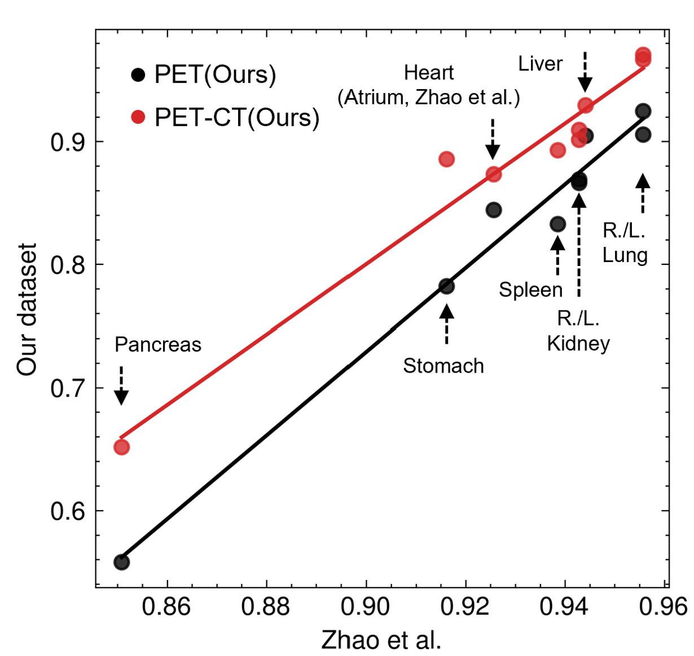

### Difficulty of a Task

From a human perspective, a task is considered difficult when it requires exceptional effort or involves complex reasoning.
In machine learning, task difficulty is more abstract but can be assessed by comparing model performance under comparable conditions.

For instance, in organ segmentation, model performance varies substantially across organs. 

Surprisingly, these differences remain consistent across different models and datasets ([Park et al.](https://www.nature.com/articles/s41598-026-51023-x)), suggesting that task difficulty may partly arise from intrinsic properties of individual organs rather than model- or dataset-specific factors.

Task difficulty should also be understood in relation to what can reasonably be achieved using a simple baseline. 
Such baselines provide a reference point for assessing not only task difficulty but also the additional value of more sophisticated models.

A recent study by [Ellington et al.](https://arxiv.org/html/2610.40700v1), illustrates this issue. 
Across 36 scientific prediction tasks, automatically constructed simple baselines recovered a median of 95.5% of the performance improvement achieved by published deep learning models over trivial predictors, matching or outperforming them in 12 tasks. 
These findings suggest that seemingly impressive model performance does not necessarily reflect a substantial methodological advance.

Taken together, these observations motivate a more systematic approach to evaluating scientific machine learning.
The [Signals–Bounds–Baselines (SBB) framework](https://www.biorxiv.org/content/10.64898/2026.04.20.719650v1) provides such a perspective: identifying the information available for prediction (Signals), understanding the theoretical limits of achievable performance (Bounds), and establishing what simpler methods can already accomplish (Baselines). 
Rather than evaluating a model solely by its predictive accuracy, SBB places its performance in the context of the task's inherent predictability and the incremental value of model complexity.

